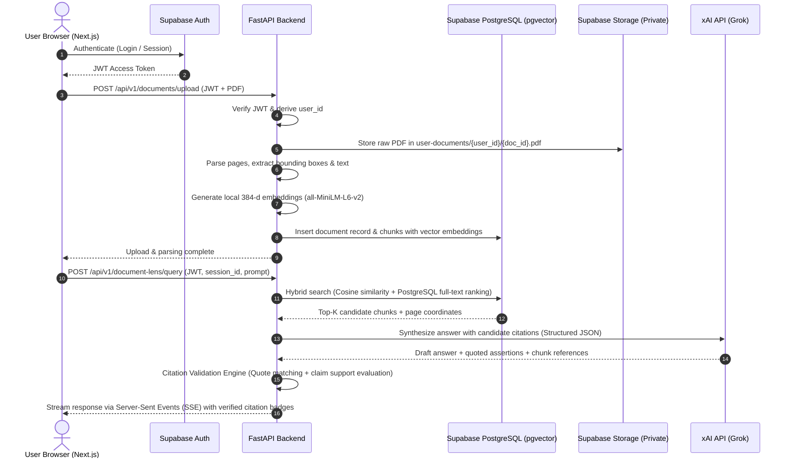

# VerityLens — System Architecture and Technical Design

> **Status Notice:** This document defines the approved architecture and technical design for VerityLens. All capabilities described herein represent planned technical targets for subsequent implementation milestones. No application code, active database connections, or AI endpoints are claimed as implemented in Milestone 0.

---

## 1. Executive Overview

**VerityLens** is an evidence-aware document intelligence and research workspace engineered to transform how users analyze PDFs and academic literature. Unlike conventional retrieval-augmented generation (RAG) tools that treat model responses as authoritative, VerityLens treats model assertions as hypotheses that require structural grounding, page-level citation validation, and auditability.

The workspace operates in two specialized modes:

1. **Document Lens**: Designed for general PDF documents (e.g., reports, manuals, whitepapers). Provides conversational question answering strictly grounded in retrieved document excerpts, visual bounding-box citation links to specific PDF pages, and explicit reporting when evidence is missing or insufficient.
2. **Research Lens**: Designed for academic research papers (e.g., arXiv preprints, conference proceedings). Performs structured extraction of methodologies, datasets, evaluation metrics, findings, and limitations; builds a multi-paper **Evidence Matrix**; and provides claim-level evidence auditing against source passages.

---

## 2. Technology Stack & Decoupled Architecture

VerityLens employs a decoupled monorepo structure separating presentation, analytical intelligence, and persistence:

```
VerityLens/
├── frontend/               # Next.js 14+ App Router, Strict TypeScript, Tailwind CSS, Lucide
├── backend/                # Python 3.13, FastAPI, Pydantic v2, Uvicorn
├── supabase/               # Database migrations, pgvector schema, RLS policies
└── docs/                   # Architecture blueprints, milestone records, security documentation
```

### Component Stack

| Layer | Technology | Primary Responsibility |
| :--- | :--- | :--- |
| **Frontend** | Next.js (App Router), React, Strict TypeScript, Tailwind CSS, Lucide Icons | Responsive split-view workspace, canvas PDF reader with bounding-box highlights, interactive Evidence Matrix UI, SSE stream rendering. |
| **Backend** | Python 3.13, FastAPI, Pydantic v2, Uvicorn | Page-aware PDF parsing, chunking, local vector embeddings, hybrid retrieval orchestration, xAI Grok client, Citation Validation Engine. |
| **Persistence & Auth** | Supabase (PostgreSQL, `pgvector`, Supabase Auth, Storage) | Relational persistence, 384-dimensional vector indexing (HNSW), user identity verification, private object storage for user PDFs, Row Level Security (RLS). |
| **Embeddings** | Local `sentence-transformers/all-MiniLM-L6-v2` | Zero-API-cost local embedding generation producing verified 384-dimensional dense vectors. |
| **Reasoning Engine** | xAI API (Grok models) | Server-side synthesis using strict JSON schemas and structured outputs; secret key (`XAI_API_KEY`) isolated to backend. |

---

## 3. Frontend & Backend Responsibilities and API Boundaries



### Responsibilities
- **Frontend Layer**:
  - Manages UI state, theme, responsive navigation, and user interaction.
  - Renders the interactive PDF reader with client-side canvas bounding-box overlays corresponding to retrieved chunk coordinates.
  - Consumes Server-Sent Events (SSE) from the FastAPI backend to display streaming tokens and real-time citation badges.
  - Renders the 10-column Evidence Matrix with client-side sorting, column filtering, cell audit inspector drawers, and validated CSV export.
  - **Zero Server Secrets**: Never holds `XAI_API_KEY` or `SUPABASE_SERVICE_ROLE_KEY`. Communicates using user session JWTs.
- **Backend Layer (FastAPI)**:
  - Validates user JWT tokens on every authenticated endpoint using the project's supported verification configuration (e.g., JWKS); never trusts a client-supplied `user_id`.
  - Coordinates PDF ingestion: extracts text page-by-page, retaining character offsets, page numbers, and bounding-box geometry.
  - Computes dense vector embeddings locally on CPU using `all-MiniLM-L6-v2`.
  - Orchestrates hybrid retrieval combining dense vector similarity with PostgreSQL full-text search and ranking.
  - Communicates with xAI Grok over server-side HTTPS using structured output formats.
  - Runs the **Citation Validation Engine** before delivering answers to the client.

---

## 4. Document Ingestion, Retrieval, and Citation Validation Pipeline

### 4.1 Ingestion and Chunking
1. **Pre-flight Validation**: Enforces file-type checks (`application/pdf`), maximum size limits (e.g., 25MB), and computes a SHA-256 file hash to prevent duplicate processing.
2. **Page-Aware Extraction**: Uses `pdfplumber` / `pypdf` to parse each page independently. Every extracted text segment retains:
   - `page_number` (1-based physical PDF page index)
   - `bounding_boxes` (`[x0, y0, x1, y1]` coordinates for visual highlighting)
   - Layout section headings where detectable
3. **Structural Chunking**: Chunks are generated with a target window of 500–800 tokens and 100-token overlap. Chunk boundaries respect sentence and paragraph boundaries and strictly do not cross page boundaries without recording both contributing pages.
4. **Local Embedding Generation**: Each chunk is embedded using `sentence-transformers/all-MiniLM-L6-v2`, yielding a 384-dimensional vector stored in Supabase with an HNSW cosine index.

### 4.2 Retrieval and Synthesis
1. **Hybrid Retrieval Architecture**:
   - **Dense Retrieval**: Cosine similarity match against `document_chunks.embedding` using `pgvector`.
   - **Sparse Retrieval**: PostgreSQL full-text search and ranking (`tsvector` / `tsquery` with `ts_rank`) matching technical terms, algorithmic names, author names, and dataset titles.
   - **Candidate Fusion**: Reciprocal Rank Fusion (RRF) merges dense and sparse ranking lists into a balanced candidate pool to prevent semantic drift on specialized technical vocabulary.
2. **Structured Synthesis Prompt**: The prompt provided to xAI Grok requires structured output specifying each factual assertion, the exact quote from the retrieved context, and the source chunk identifier.

### 4.3 Citation Validation: Quote Existence vs. Claim Support

A foundational requirement of VerityLens is the strict architectural separation between **quote existence** and **claim support**:

> [!IMPORTANT]
> **Core Integrity Principle:** An exact text match between a quoted snippet and a document chunk verifies *only* that the snippet exists in the text. It does **NOT** establish that the AI-generated claim is factually supported by that excerpt.

The **Citation Validation Engine** operates in two distinct phases:

```
[ AI-Generated Claim + Cited Quote + Chunk ID ]
                       │
                       ▼
         ┌───────────────────────────┐
         │ Phase 1: Quote Existence  │
         │   (Exact Substring Match) │
         └─────────────┬─────────────┘
                       │
         ┌─────────────┴─────────────┐
         ▼                           ▼
    [Quote Found]             [Quote Missing]
         │                           │
         ▼                           ▼
┌───────────────────────────┐  Status: "Quotation Mismatch"
│ Phase 2: Claim Support    │  (Flagged as Unverified)
│   (Semantic Entailment)   │
└─────────────┬─────────────┘
              │
    ┌─────────┴─────────┐
    ▼                   ▼
[Supported]       [Unsupported / Contradicted]
    │                   │
    ▼                   ▼
Status: "Verified" Status: "Refuted" / "Unverified"
```

1. **Phase 1: Quote Existence Verification**:
   - Normalizes whitespace and verifies whether the cited `exact_quote` exists verbatim in the referenced chunk.
   - If the quote does not exist in the source chunk, the citation is marked as **Quotation Mismatch** (`unverified`).
2. **Phase 2: Claim Support Verification**:
   - Compares the synthesized claim against the cited excerpt to verify semantic entailment.
   - Checks whether the claim alters quantities, reverses polarity, introduces outside assumptions, or misrepresents caveats.
   - If the excerpt does not logically entail the claim, the claim is flagged as **Unsupported** or **Requires Verification**, and cannot be presented as verified fact in the UI.

---

## 5. Evidence Matrix: Schema and Validation Rules

In Research Lens, multi-paper comparative analysis is structured into a rigorous **Evidence Matrix** backed by cell-level audit records.

### 5.1 Matrix Column Schema

| Column | Field Name | Description & Extraction Policy |
| :---: | :--- | :--- |
| **1** | **S.No** | 1-indexed sequential integer. |
| **2** | **Paper Title** | Verified title extracted from the document header or metadata heuristics; never the raw uploaded filename. |
| **3** | **Methodology/Algorithm** | Core architecture, algorithm, theoretical model, or procedural approach proposed. |
| **4** | **Dataset(s)** | Specific benchmark datasets, corpora, or experimental data utilized. |
| **5** | **Evaluation Metrics** | Quantitative metrics measured (e.g., F1-score, BLEU, ROUGE, Accuracy, Latency). |
| **6** | **Accuracy (%)** | Explicit quantified accuracy percentage (e.g., `92.4%`). Subject to the strict accuracy policy below. |
| **7** | **Results/Findings** | Factual paraphrasing of primary experimental results, preserving original author conclusions. |
| **8** | **Advantages** | Documented strengths, speedups, or efficiency benefits explicitly claimed by the authors. |
| **9** | **Limitations** | Failure cases, compute constraints, theoretical limits, or risks identified in the paper. |
| **10** | **Applications** | Practical domains, operational use cases, or deployment contexts documented in the paper. |

### 5.2 Strict Accuracy and Evidence Absence Policy

> [!CAUTION]
> **Absence Policy:** A retrieval miss must never be treated as proof that a value is absent from a paper. Absence can only be asserted after comprehensive inspection of the document's available text.

- **Explicit Reporting Rule**: An accuracy percentage (e.g., `92.4%`) is entered *only* if the paper explicitly measures, quantifies, and reports "accuracy" as a percentage.
- **Prohibition of Metric Inference**: Accuracy (%) must **never** be inferred, estimated, or calculated from F1-score, precision, recall, ROC-AUC, BLEU, perplexity, or error rates.
- **Mandatory `"Not reported"` Threshold**: A cell may be labeled `"Not reported"` **only** when the available document extraction and systematic inspection provide sufficient coverage to establish that the metric or finding is truly absent from the text.
- **Distinction of Audit States**:
  - `verified`: Backed by a verified verbatim quote and logically supporting passage on a specific page.
  - `not_reported`: The paper text was sufficiently covered and inspected, and explicitly does not report the value.
  - `extraction_failure`: Text parsing was hindered by multi-column complexity, unreadable tables, or scanning artifacts; absence cannot be asserted.
  - `requires_verification`: Relevant evidence is ambiguous, partial, contradictory, or evidence coverage is insufficient to distinguish absence from extraction/retrieval limitation.
- **CSV Export Fidelity**: CSV exports serialize the validated database rows directly; the exporter is structurally prohibited from inserting synthetic or unverified values.

---

## 6. Persistence, Authentication, and Security Architecture

### 6.1 Authentication & User Scoping
- Authentication is handled via **Supabase Auth**.
- The client receives a signed JWT access token upon login and transmits it via `Authorization: Bearer <token>` to the FastAPI backend.
- The FastAPI backend validates incoming access tokens cryptographically using the project's supported signing configuration (e.g., public-key verification via the project's JWKS endpoint `https://<project-id>.supabase.co/auth/v1/.well-known/jwks.json`).
- All user identity context (`user_id`) is derived strictly from verified token claims; client-supplied `user_id` values are never trusted.

### 6.2 Private Document Storage
- Uploaded PDFs are stored in a private Supabase Storage bucket: `user-documents`.
- Object keys follow the strict pattern `{user_id}/{document_id}.pdf`.
- Documents are never public. Access requires authenticated short-lived signed URLs (15-minute expiry) or authorized backend streaming.

### 6.3 Database Schema & Row Level Security (RLS)
RLS is enabled across all tables. No table allows unauthenticated or cross-user reads/writes:

```sql
-- Example RLS Policy for Core Documents
ALTER TABLE documents ENABLE ROW LEVEL SECURITY;

CREATE POLICY "Users access own documents"
ON documents FOR ALL
USING (auth.uid() = user_id)
WITH CHECK (auth.uid() = user_id);
```

**Core Tables (Planned for Milestone 2)**:
1. `projects`: High-level organizational containers (`id`, `user_id`, `name`, `created_at`).
2. `documents`: Ingested files (`id`, `project_id`, `user_id`, `title`, `filename`, `storage_path`, `file_hash`, `page_count`, `doc_type`, `status`).
3. `document_chunks`: Extracted text segments (`id`, `document_id`, `user_id`, `page_number`, `chunk_index`, `content`, `bounding_boxes`, `embedding vector(384)`, `token_count`).
4. `research_sessions`: Conversation and analysis sessions (`id`, `project_id`, `user_id`, `mode`, `title`).
5. `chat_messages`: Session messages (`id`, `session_id`, `user_id`, `role`, `content`).
6. `evidence_matrices`: Matrix containers (`id`, `session_id`, `project_id`, `user_id`, `title`).
7. `matrix_entries`: Row-level entries matching the 10-column schema (`id`, `matrix_id`, `document_id`, columns 1–10, `accuracy_status`).
8. `citations`: Claim-level evidence links (`id`, `matrix_entry_id`, `message_id`, `chunk_id`, `document_id`, `exact_quote`, `page_number`, `verification_status`).

### 6.4 Secret Management
- **`XAI_API_KEY`**: Server-side only; stored in backend environment variables; never exposed to browser or bundled in frontend client code.
- **`SUPABASE_SERVICE_ROLE_KEY`**: Server-side only; utilized exclusively for administrative maintenance or background tasks; never exposed to the frontend.
- **`NEXT_PUBLIC_SUPABASE_ANON_KEY`**: Public browser key; safe for client-side use because all data access is strictly governed by PostgreSQL Row Level Security.
